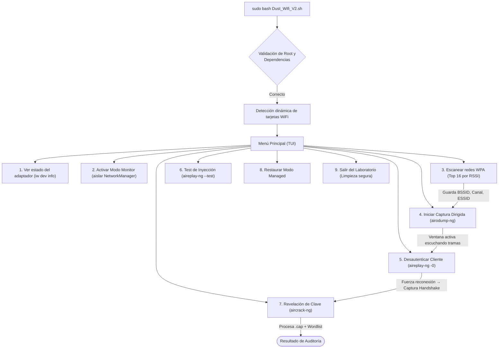

# 📡 Dust-WiFi v2.0 — Educational Wireless Security & WPA Audit Kit

[](LICENSE)
[]()
[]()
[]()
[]()

**Dust-WiFi v2.0** es una herramienta educativa basada en **TUI (*Text User Interface*) con `whiptail`** diseñada para la enseñanza práctica de seguridad en redes inalámbricas IEEE 802.11, auditoría de protocolos **WPA/WPA2-PSK** y criptoanálisis de claves en entornos académicos y de laboratorio.

El objetivo del proyecto es permitir que los estudiantes de ciberseguridad, telemática e ingeniería de redes comprendan el funcionamiento interno del **4-Way Handshake**, las tramas de gestión inalámbricas y los vectores de ataque/defensa, abstrayendo la complejidad sintáctica inicial de la consola pero manteniendo visibilidad de los comandos subyacentes.

---

## ⚠️ AVISO LEGAL Y DESCARGO DE RESPONSABILIDAD (DISCLAIMER)

> [!CAUTION]
> **USO EXCLUSIVO EN ENTORNOS CONTROLADOS O CON AUTORIZACIÓN EXPRESA**
>
> 1. Este software ha sido desarrollado **estrictamente con propósitos educativos, pedagógicos, de investigación y de evaluación de seguridad autorizada**.
> 2. Queda terminantemente prohibido su uso sobre redes inalámbricas, dispositivos o infraestructuras sobre las cuales **no se posea autorización explícita y por escrito** del propietario o administrador legítimo.
> 3. La interceptación no autorizada de comunicaciones electromagnéticas y la inyección o alteración de tramas de red puede constituir un **delito grave** tipificado en las leyes locales e internacionales (por ejemplo, la legislación sobre Delitos Informáticos, el Convenio de Budapest y regulaciones de telecomunicaciones).
> 4. Los autores, desarrolladores y colaboradores **no asumen ninguna responsabilidad directa ni indirecta** por el mal uso, daños, pérdidas de servicio o consecuencias legales derivadas de la utilización de esta herramienta.

---

## 🎯 Características Principales

* 🖥️ **Interfaz TUI Interactiva:** Diseñada con diálogos `whiptail` en consola, evitando errores tipográficos en el aula.
* 🔍 **Escaneo Espectral Inteligente:** Barrido temporal (20 s) con barra de progreso, filtrado automático de redes WPA/WPA2 y ordenamiento descendente de las **Top 16 redes por potencia de señal (RSSI en dBm)**.
* 💾 **Auto-completado de Objetivos:** Guarda en memoria el BSSID, Canal, ESSID y señal de la red seleccionada para pre-cargarlos automáticamente en las fases de captura y desautenticación.
* 🪟 **Lanzador de Terminales Desacoplado:** Arquitectura multi-ventana resiliente con prioridad `xterm` (sin dependencias de D-Bus de usuario) y *fallbacks* a `gnome-terminal` (vía `dbus-launch`) y `xfce4-terminal`, eliminando errores de display al correr bajo `sudo`.
* ⚡ **Desautenticación Modular y Quirúrgica:** Permite apuntar a una estación específica (`Station MAC`) o en broadcast, con selección configurable de tramas (1–5 frames, ráfagas o continuo).
* 📁 **Navegador de Archivos TUI Integrado:** Explorador interactivo de carpetas para seleccionar archivos `.cap` y diccionarios (`wordlists`) en cualquier ruta del disco.
* 🛡️ **Guardián de Hardware y Precondiciones:** Verifica dinámicamente que la interfaz se encuentre en modo monitor antes de lanzar capturas, inyecciones o desautenticaciones.
* 🔄 **Limpieza Segura y Restauración de Red (`trap`):** Intercepta señales `SIGINT` (Ctrl+C) y `SIGTERM`, restaurando el modo `managed` y reactivando `NetworkManager` para dejar los equipos del laboratorio con Internet funcional al terminar la clase.
* 📊 **Organización por Sesiones:** Almacena automáticamente los archivos generados en directorios estructurados: `./capturas/YYYY-MM-DD_HH-MM/`.

---

## 📐 Flujo de Trabajo del Laboratorio



---

## 🛠️ Requisitos del Sistema

### Hardware Recomendado
* Computadora con sistema operativo Linux.
* Adaptador inalámbrico USB compatible con **Modo Monitor** e **Inyección de Paquetes**.
  * Chipsets recomendados: Atheros AR9271, Ralink RT3070 / RT3572, MediaTek MT7601U, Realtek RTL8812AU / RTL8814AU (con drivers actualizados).

### Dependencias de Software
El script requiere los siguientes paquetes en distribuciones Debian / Ubuntu:

```bash
sudo apt update
sudo apt install -y aircrack-ng whiptail iw iproute2 xterm network-manager
```

---

## 🚀 Instalación y Puesta en Marcha

1. **Clonar el repositorio:**
   ```bash
   git clone https://github.com/tu-usuario/Dust-Wifi.git
   cd Dust-Wifi
   ```

2. **Otorgar permisos de ejecución:**
   ```bash
   chmod +x Dust_Wifi_V2.sh
   ```

3. **Ejecutar el script con privilegios de superusuario:**
   ```bash
   sudo bash Dust_Wifi_V2.sh
   ```

---

## 📋 Módulos y Opciones del Menú

| Opción | Módulo | Herramientas Utilizadas | Descripción Técnica |
| :---: | :--- | :--- | :--- |
| **1** | **Estado del Adaptador** | `iw dev`, `iw phy` | Muestra detalles del chip, canales y capacidades soportadas. |
| **2** | **Activar Modo Monitor** | `nmcli`, `ip`, `iw` | Desvincula la interfaz de NetworkManager y activa el modo promiscuo RF. |
| **3** | **Escanear Redes WPA** | `airodump-ng`, `awk`, `sort` | Escaneo temporizado (20 s), filtrado WPA y visualización del Top 16 por dBm. |
| **4** | **Capturar Handshake** | `airodump-ng`, `xterm` | Bloquea el canal de radio y escucha tramas EAPOL en ventana dedicada. |
| **5** | **Desautenticar Cliente** | `aireplay-ng -0` | Inyecta tramas de desautenticación a un cliente específico o broadcast. |
| **6** | **Test de Inyección** | `aireplay-ng --test` | Certifica la capacidad de inyección de paquetes del hardware. |
| **7** | **Revelar Clave WPA** | `aircrack-ng` | Detección de `.cap`, comprobación de handshake y ataque por diccionario. |
| **8** | **Restaurar Managed** | `ip`, `iw`, `nmcli` | Restaura la interfaz a modo cliente y reactiva la conexión normal a Internet. |
| **9** | **Salir** | Función `salida_segura` | Cierre interactivo con confirmación de restauración de red. |

---

## 📂 Estructura del Repositorio

```text
├── Dust_Wifi_V2.sh                  # Script principal interactivo (TUI en Bash)
├── Clase_Teoria_Seguridad_WiFi_WPA.md # Dossier teórico completo para docentes (Fundamentos 802.11)
├── capturas/                        # Directorio generado automáticamente para los volcados .cap
├── README.md                        # Documentación técnica del proyecto
└── LICENSE                          # Licencia de código abierto
```

---

## 🛡️ Medidas Defensivas y Buenas Prácticas (Hardening)

Como resultado pedagógico de las auditorías realizadas con esta herramienta, se promueve la adopción de las siguientes contramedidas en redes corporativas y hogareñas:

1. **Migración a WPA3-Personal (SAE):** El protocolo *Dragonfly* elimina por completo la vulnerabilidad a ataques de diccionario offline mediante autenticación de conocimiento cero y *Forward Secrecy*.
2. **Habilitación de IEEE 802.11w (PMF - Protected Management Frames):** Configurado en modo *Required*, protege criptográficamente las tramas de desautenticación, neutralizando los ataques de `aireplay-ng -0`.
3. **Complejidad y Entropía de Contraseñas:** Si se utiliza WPA2, la clave compartida (PSK) debe superar los 16 caracteres alfanuméricos con símbolos ($\approx 105 \text{ bits}$ de entropía) para resistir ataques por diccionario y tablas precomputadas.
4. **Adopción de WPA2/WPA3 Enterprise (802.1X):** Empleo de servidores de autenticación centralizada (RADIUS) con EAP-TLS y certificados digitales individuales, erradicando las claves compartidas.
5. **Wireless Client Isolation y Segmentación:** Prohibir la comunicación directa entre estaciones inalámbricas en Capa 2 y segmentar el tráfico mediante VLANs específicas.

---

## 🤝 Contribuciones

Las contribuciones que enriquezcan el valor pedagógico del proyecto son bienvenidas:
1. Haz un Fork del repositorio.
2. Crea una rama para tu función (`git checkout -b feature/nueva-mejora`).
3. Haz commit de tus cambios (`git commit -m 'Añade nueva funcionalidad pedagógica'`).
4. Haz push a la rama (`git push origin feature/nueva-mejora`).
5. Abre un **Pull Request**.

---

## 📄 Licencia

Este proyecto se distribuye bajo la licencia **MIT**. Consulta el archivo `LICENSE` para más información.

---
*Diseñado con fines docentes y de investigación en seguridad inalámbrica &copy; 2026.*

